# Complete Project Learning Guide & Data Flow
## Understanding OSMS: How the University Timetabling System Works From Scratch


---

```
                                      TABLE OF CONTENTS
  ┌─────────────────────────────────────────────────────────────────────────────────────────┐
  │  1. Visual Master Data Flow Infographic (Every Step Separated & Mapped)                 │
  │  2. Step-by-Step Descriptive Walkthrough (From Raw Data to Final Timetable)             │
  │     • Phase 1: Reading University Inputs (Steps 1 to 5)                                 │
  │     • Phase 2: Formulating the Puzzle Pieces (Steps 6 to 8)                             │
  │     • Phase 3: The High-Speed Bitwise Solver Engine (Steps 9 to 12)                     │
  │     • Phase 4: Overcoming Impossible Over-Constraints (Steps 13 to 14)                  │
  │     • Phase 5: Polishing the Schedule for Students & Teachers (Steps 15 to 17)          │
  │     • Phase 6: Neuro-Symbolic Generative AI Diagnostics (Steps 18 to 20)                │
  │     • Phase 7: Final Deliverables & Routine Exports (Step 21)                           │
  │  3. The Professor's Plain-English FAQ (Clear Answers to Fundamental Questions)          │
  └─────────────────────────────────────────────────────────────────────────────────────────┘
```

---

## 1. Visual Master Data Flow Infographic

Every single step in our system is separated into its own distinct stage:

```mermaid
flowchart TD
    %% ================= PHASE 1: INPUT DATA =================
    subgraph P1 ["PHASE 1: READING UNIVERSITY INPUTS (Database & Configuration)"]
        direction TB
        S1["<b>STEP 1: Institutional Calendar Rules</b><br/>• Working Days (5, 6, or 7 days)<br/>• Daily Timeslots (e.g., 14 slots of 30 mins = 09:00 AM to 04:30 PM)<br/>• Institutional Lunch Break (e.g., Slots 6 & 7 = 12:00 PM to 01:00 PM)"]
        S2["<b>STEP 2: Course Catalog & Requirements</b><br/>• Theory Courses (1.5 hours = 3 slots, meets 2 times/week)<br/>• Lab Courses (3.0 hours = 6 slots, meets 1 time/week)<br/>• Hardware Lab Specialization (Network Lab, Software Lab, Hardware Lab)"]
        S3["<b>STEP 3: Teacher Profiles & Constraints</b><br/>• Weekly Day-Off & Availability (e.g., Prof. A only available Sun, Tue, Thu)<br/>• Maximum Weekly Teaching Hours (e.g., 14 hours/week)"]
        S4["<b>STEP 4: Room Inventory & Capacities</b><br/>• Room Seating Capacity (e.g., Room 301 has 60 seats; Lab 402 has 40 seats)<br/>• Room Classification (Regular Theory Classroom vs. Specialized Computer Lab)"]
        S5["<b>STEP 5: Student Cohorts (Sections)</b><br/>• Cohort Name (e.g., Section 4A, Section 4B)<br/>• Student Enrollment Count (e.g., 52 students in Section 4A)"]
    end

    %% ================= PHASE 2: PROBLEM FORMULATION =================
    subgraph P2 ["PHASE 2: FORMULATING THE PUZZLE PIECES (Pre-Processing)"]
        direction TB
        S6["<b>STEP 6: Splitting Courses into Individual Scheduling Units ('Variables')</b><br/>• <i>Code: Main.java</i><br/>• If CSE-401 meets twice a week, create two separate puzzle pieces:<br/>  Variable 1: CSE-401_Section4A_Session1<br/>  Variable 2: CSE-401_Section4A_Session2"]
        S7["<b>STEP 7: Physical Pre-Filtering (Eliminating Impossible Rooms)</b><br/>• <i>Code: AvailabilityHelper.java</i><br/>• If Section 4A has 52 students, immediately eliminate all 40-seat rooms.<br/>• If the course is a Theory class, eliminate all specialized Computer Labs."]
        S8["<b>STEP 8: Building Candidate Options ('Domain Generation')</b><br/>• <i>Code: AvailabilityHelper.java</i><br/>• For each session, build a candidate list of valid options:<br/>  Option = {Day, Start Time, Teacher, Eligible Room}"]
    end

    %% ================= PHASE 3: CORE SOLVER =================
    subgraph P3 ["PHASE 3: THE HIGH-SPEED ENGINE (Solving in CPU Registers)"]
        direction TB
        S9["<b>STEP 9: 64-Bit Digital Calendar Encoding ('Bit-Parallelism')</b><br/>• <i>Code: CSPState.java</i><br/>• Map each day into a 64-bit integer ('long').<br/>• Bit 0 = 09:00 AM, Bit 1 = 09:30 AM, ..., Bit 13 = 04:30 PM.<br/>• A 1.5h class is a 3-bit mask: 0b111 shifted to start time."]
        S10["<b>STEP 10: Picking the Hardest Class First ('MRV + Degree Heuristics')</b><br/>• <i>Code: Heuristics.selectMRVDegree()</i><br/>• <b>MRV (Minimum Remaining Values):</b> Picks the class with fewest valid slots left (Fail-First).<br/>• <b>Degree Heuristic (Tie-Breaker):</b> If tied, picks the class that conflicts with the most<br/>  other classes (v.neighbors.size()) to resolve major bottlenecks early!"]
        S11["<b>STEP 11: Instant 1-Clock-Cycle Clash Check</b><br/>• <i>Code: CSPSolver.consistent()</i><br/>• Check: Is the Teacher free? Is the Room free? Is the Section free? Is it Lunch?<br/>• Done in 1 CPU cycle: ((Teacher | Room | Section | Lunch) & ClassMask) == 0"]
        S12["<b>STEP 12: Assigning the Class & Narrowing Future Options ('Forward Checking')</b><br/>• <i>Code: ForwardChecker.prune()</i><br/>• Mark bits as occupied (state |= mask).<br/>• Proactively remove this time slot from other classes sharing this teacher or room."]
    end

    %% ================= PHASE 4: OVER-CONSTRAINT =================
    subgraph P4 ["PHASE 4: HANDLING IMPOSSIBLE SCHEDULES (The Breakthrough)"]
        direction TB
        S13["<b>STEP 13: What If a Class Has No Free Slot? ('Adaptive Soft-Skipping')</b><br/>• <i>Code: CSPSolver.solve() lines 232-238</i><br/>• Traditional Solvers: CRASH and give up with 'No Solution Found'.<br/>• Our Solver: Flags this class as 'TBA (Skipped for Now)' and CONTINUES<br/>  solving all remaining courses!"]
        S14["<b>STEP 14: Retrying Skipped Classes Later ('Dynamic Backtracking')</b><br/>• <i>Code: CSPSolver.solve()</i><br/>• If earlier classes change rooms or days during search, the solver resets<br/>  v.skipped = false and tries to fit the skipped course again."]
    end

    %% ================= PHASE 5: QUALITY & SOFT CONSTRAINTS =================
    subgraph P5 ["PHASE 5: POLISHING FOR STUDENTS & TEACHERS (Soft Constraints)"]
        direction TB
        S15["<b>STEP 15: Dual-Tier Tournament Selection</b><br/>• <i>Code: CSPSolver.solve() lines 148-189</i><br/>• Whenever a complete schedule is generated, compare it to the current best:<br/>  Rule 1: More classes scheduled ALWAYS wins (e.g., 49/50 beats 48/50).<br/>  Rule 2: If tied, pick the schedule with the lowest penalty score."]
        S16["<b>STEP 16: Eliminating Student Campus Waiting Gaps ('Curriculum Compactness')</b><br/>• <i>Code: SoftConstraints.sectionIdleGapPenalty()</i><br/>• Detects idle gaps (e.g., class at 9 AM, 4-hour gap, then lab at 2 PM).<br/>• Uses bitwise XOR: emptyMask = spanMask ^ dayMask in 1 CPU cycle.<br/>• Heavily penalizes wasted gaps to group student classes back-to-back."]
        S17["<b>STEP 17: Balancing Teacher Workloads & Section Days</b><br/>• <i>Code: SoftConstraints.java</i><br/>• Penalizes giving a teacher >6 classes in a week.<br/>• Penalizes dragging a student section to campus for >4 days a week."]
    end

    %% ================= PHASE 6: AI DIAGNOSTICS =================
    subgraph P6 ["PHASE 6: GENERATIVE AI DIAGNOSTICS (Explainability)"]
        direction TB
        S18["<b>STEP 18: Scanning Unscheduled Classes ('Bottleneck Extractor')</b><br/>• <i>Code: AIPromptGenerator.java</i><br/>• If any course remains skipped, the system scans when the teacher was free,<br/>  when the section was free, and which rooms were occupied."]
        S19["<b>STEP 19: Formulating the AI Diagnostic Prompt</b><br/>• <i>Code: AIPromptGenerator.java</i><br/>• Builds a precise mathematical conflict summary explaining the exact bottleneck."]
        S20["<b>STEP 20: Google Gemini AI Administrative Recommendation</b><br/>• <i>Code: GeminiService.java</i><br/>• Gemini analyzes the bottleneck and gives the Dean an actionable plain-English fix:<br/>  'Shift Section 4B from Room 402 to 405 on Tuesday to free the slot for Section 4A.'"]
    end

    %% ================= PHASE 7: DELIVERABLES =================
    subgraph P7 ["PHASE 7: FINAL DELIVERABLES & ROUTINE EXPORTS"]
        direction TB
        S21["<b>STEP 21: Exporting Final Schedules</b><br/>• <i>Code: CSVRoutineExporter.java & routine_matrix.jsp</i><br/>• Complete Departmental Master CSV Timetable.<br/>• Interactive Visual Routine Grid for Web Browsers.<br/>• Personalized schedules for each individual professor."]
    end

    %% ================= FLOW CONNECTIONS =================
    P1 ==> P2
    S1 --> S6
    S2 --> S6
    S3 --> S7
    S4 --> S7
    S5 --> S7
    S6 --> S7 --> S8

    P2 ==> P3
    S8 --> S9 --> S10 --> S11 --> S12

    P3 ==> P4
    S11 -- "Clash Occurs / No Slot" --> S13
    S12 -- "Try Other Branches" --> S14
    S13 --> S14

    P4 ==> P5
    S12 -- "Leaf Schedule Found" --> S15
    S14 --> S15
    S15 --> S16 --> S17

    P5 ==> P6
    S17 -- "Any Courses Unassigned?" --> S18 --> S19 --> S20

    P5 ==> P7
    S17 -- "Schedule Completed" --> S21
    S20 -.->|"Dean Applies AI Suggestion"| P1
```



---

## 2. Step-by-Step Descriptive Walkthrough

### Phase 1: Reading University Inputs (The Raw Ingredients)

Before any algorithm can run, the system must collect five pieces of real-world information from the university database:

#### Step 1: Institutional Calendar Rules
* **What it is:** The operating schedule of the university.
* **Input Example:** 
  * Working Days: 5 days (Sunday to Thursday).
  * Timeslots per Day: 14 slots of 30 minutes each (09:00 AM to 04:30 PM).
  * Lunch Break: Slot 6 & Slot 7 (12:00 PM to 01:00 PM).
* **Why it matters:** Defines the physical boundaries of the weekly timetable.

#### Step 2: Course Catalog & Requirements
* **What it is:** Every course that needs to be taught this semester.
* **Input Example:**
  * `CSE-401 (Advanced Algorithms)`: **Theory** course. Needs **1.5 hours (3 slots)** per class, and meets **2 times per week** (total 3 hours).
  * `CSE-402 (Network Lab)`: **Lab** course. Needs **3.0 hours (6 slots)** continuously, and meets **1 time per week**. Requires specialized `NETWORK_LAB` hardware.
* **Why it matters:** Courses have asymmetric lengths. Labs cannot be broken up into short pieces, and theory classes cannot be taught in a network hardware room.

#### Step 3: Faculty Profiles & Constraints
* **What it is:** Which professors are available, and on which days.
* **Input Example:** Prof. Rahman is only on campus on Sunday, Tuesday, and Thursday. His maximum contract is 14 hours per week.
* **Why it matters:** The system must never schedule a teacher on their off-day or exceed their weekly workload.

#### Step 4: Room Inventory & Capacities
* **What it is:** The physical building layout.
* **Input Example:** Room 301 (Theory room, 60 seats); Room 402 (Network Lab, 40 computer terminals).
* **Why it matters:** A class of 50 students cannot be crammed into a 40-seat room.

#### Step 5: Student Cohorts (Sections)
* **What it is:** The student groups who attend classes together.
* **Input Example:** Section 4A has 52 students; Section 4B has 48 students.
* **Why it matters:** No section can be scheduled in two places at the same time.

---

### Phase 2: Formulating the Puzzle Pieces (Pre-Processing)

#### Step 6: Splitting Courses into Scheduling Units ("Variables")
* **What it does:** In computer science, an entity that needs a decision is called a **Variable**.
* **Plain-English Example:**  
  If Course `CSE-401` meets **2 times a week** for Section 4A:
  * The system creates **Variable 1:** `CSE-401_4A_Session1` (needs 1.5 hours).
  * The system creates **Variable 2:** `CSE-401_4A_Session2` (needs 1.5 hours).
* **Output:** A list of independent class sessions that need to be placed on the weekly calendar.

#### Step 7: Physical Pre-Filtering (Eliminating Impossible Rooms)
* **What it does:** Before wasting time searching, immediately throw away options that violate physical reality.
* **Plain-English Example:**
  * Section 4A has 52 students. The system scans all rooms and **immediately eliminates** all rooms with capacity $< 52$.
  * If the class is `CSE-401 (Theory)`, the system **immediately eliminates** all lab rooms.
* **Output:** Each class session only considers physically valid rooms.

#### Step 8: Building Candidate Options ("Domain Generation")
* **What it does:** For each class session, generate all theoretically possible combinations of `(Day, Start Time, Teacher, Room)`. This candidate list is called the variable's **Domain**.
* **Output:** Each session has a list of candidate slots where it could physically take place.

---

### Phase 3: The High-Speed Solver Engine (Solving in CPU Registers)

#### Step 9: 64-Bit Digital Calendar Encoding ("Bit-Parallelism")
* **The Traditional Problem:** Most software uses slow database queries or nested loops over Java objects to check if a room is occupied.
* **Our Innovation:** We turn every single day into a **single 64-bit number** (`long` in Java):
  ```
  Time:   09:00  09:30  10:00  10:30  11:00  11:30  12:00  12:30  01:00  01:30
  Slot:     0      1      2      3      4      5      6      7      8      9
  Bits:   [ 0      0      1      1      1      0      0      0      0      0 ]
  ```
  * Bit = 0 means the slot is **Free**.
  * Bit = 1 means the slot is **Occupied**.
* **Why it is revolutionary:** 64-bit numbers fit directly into the computer's CPU registers. Checking clashes requires **zero memory allocations**.

#### Step 10: Picking the Hardest Class First ("MRV + Degree Heuristics")
* **Code Implementation:** `algorithm.Heuristics.selectMRVDegree()`
* **Part A: MRV (Minimum Remaining Values / "Fail-First"):**  
  * *The Principle:* Pick the variable with the smallest candidate domain (`d < minDomain`).
  * *Plain-English Example:* Imagine you are packing a suitcase: you pack the large, rigid items first, not the small socks. If a 3-hour Lab that requires a specialized Network Lab room only has **2 possible slots** left in the whole week, while an ordinary Theory class has **40 possible slots**, the solver picks the Lab FIRST! That way, we don't accidentally let easy classes steal the Lab's only slots.
* **Part B: The Degree Heuristic (The Smart Tie-Breaker):**  
  * *The Question:* What if two classes are tied with the exact same number of remaining slots (e.g., both have only 2 slots left)? Which one should the computer choose?
  * *The Degree Heuristic Solution:* The solver counts how many neighboring classes share the same student section (`deg = v.neighbors.size()`).
  * *The Rule:* It selects the class with the **highest degree** (`d == minDomain && deg > maxDegree`). By assigning the class that affects the most other courses first, it resolves the biggest bottleneck early and prevents cascading deadlocks later.

#### Step 11: Instant 1-Clock-Cycle Clash Check
* **What it does:** Verifies that Teacher, Room, Section, and Lunch Break are all simultaneously free.
* **The Formula:**
  $$\big(\mathbf{Teacher}_{\text{occupied}} \lor \mathbf{Room}_{\text{occupied}} \lor \mathbf{Section}_{\text{occupied}} \lor \mathbf{Lunch}_{\text{mask}}\big) \land \mathbf{ClassMask} == 0$$
* **Plain-English Meaning:**
  1. Combine the busy schedules of Teacher, Room, Section, and Lunch using bitwise OR ($\lor$).
  2. Overlay the proposed class mask using bitwise AND ($\land$).
  3. If the answer is `0`, **no collision exists**!
* **Speed:** Executes in **1 CPU clock cycle** ($0.000000005$ seconds). Enables checking **150,000 to 300,000 states per second**!

#### Step 12: Assigning the Class & Narrowing Future Options ("Forward Checking")
* **What it does:** As soon as a class is assigned to a slot:
  * Set the bits to `1` in the Teacher's, Room's, and Section's masks.
  * **Forward Checking:** Proactively inspect all remaining unassigned classes. If any other class shares this teacher or room, remove this time slot from their candidate lists so we don't try it later and waste time.

---

### Phase 4: Overcoming Impossible Schedules (The Core Breakthrough)

#### Step 13: What Happens When a Class Cannot Fit? ("Adaptive Soft-Skipping")
* **The Fatal Flaw of All Existing Tools (e.g., Ponzio IEEE 2026, Alexa 2021):**  
  In a real university, resources are tight. If even ONE course cannot fit, traditional exact solvers hit a dead end, abort, and output **"No Solution Found"**. The administrator gets zero schedule.
* **Our Breakthrough — Adaptive Soft-Skipping:**  
  When a course session has no clash-free slot:
  1. The solver **DOES NOT CRASH**.
  2. It marks the course: `v.skipped = true` (flagged as "To Be Arranged / TBA").
  3. It **continues searching** and successfully schedules all the other 49 courses!

#### Step 14: Retrying Skipped Classes Later ("Dynamic Backtracking")
* **What it does:** As the search explores different branches, earlier class assignments change rooms or days.
* **The Action:** Whenever the solver backtracks, it resets `v.skipped = false` and tests if the previously unassigned class can now fit into the newly opened space.

---

### Phase 5: Polishing the Schedule (Soft Constraints)

#### Step 15: Dual-Tier Tournament Selection
* **What it does:** During the search, multiple complete schedules will be found. How does the computer know which one is the "best"?
* **The Two Rules:**
  * **Tier 1 (Completeness):** The schedule that has more courses assigned ALWAYS wins. (A schedule with 50/50 courses scheduled will always beat 49/50).
  * **Tier 2 (Quality):** If two schedules have the same number of assigned courses, pick the one with the lowest soft penalty score.

#### Step 16: Eliminating Student Campus Waiting Gaps ("Curriculum Compactness")
* **The Problem:** Students hate having a class at 09:00 AM, sitting around campus idle for 4 hours, and then having a second class at 02:00 PM.
* **Our Solution:** We detect idle waiting gaps using hardware bitwise logic:
  ```
  Class Schedule on Monday:   0 0 1 1 0 0 0 0 1 1 0 0   (Classes at 10:00 AM and 02:00 PM)
  Continuous Span:            0 0 1 1 1 1 1 1 1 1 0 0   (Everything from first to last class)
  ───────────────────────────────────────────────────
  Empty Waiting Gap:          0 0 0 0 1 1 1 1 0 0 0 0   (Span ^ DayMask -> Slots 4, 5, 6, 7)
                                         ▲
                           4 hours of wasted waiting detected!
  ```
* **The Action:** The solver penalizes non-lunch idle gaps heavily ($25 \times \text{empty slots}$), automatically pushing student classes together into compact morning or afternoon blocks.

#### Step 17: Balancing Teacher Workload & Section Day Spread
* Penalizes assigning more than 6 classes to a single teacher in a week.
* Penalizes spreading a student section's classes over more than 4 days (protects student study days).

---

### Phase 6: Generative AI Diagnostics (The Explainability Layer)

#### Step 18: Scanning Unscheduled Classes ("Bottleneck Extractor")
* If an institutional schedule was physically impossible (e.g., 50 courses requested, but only 48 could physically fit due to room deficits):
* `AIPromptGenerator.java` scans the exact state:
  * When was the section free?
  * When was the teacher free?
  * Why couldn't they meet? (e.g., "All 60-seat rooms were occupied on Tuesday").

#### Step 19: Formulating the AI Diagnostic Prompt
* Translates the mathematical conflict into a structured diagnostic query.

#### Step 20: Google Gemini AI Administrative Recommendation
* The system queries the Google Gemini API.
* Gemini acts as an expert academic consultant and returns plain-English advice to the Dean:
  > *"Course CSE-401 cannot be scheduled because Room 402 is occupied on Tuesday Period 2 by Section 4B. However, Room 405 is completely empty at that time.  
  > **Actionable Fix:** Move Section 4B from Room 402 to Room 405. This frees Room 402 and allows Section 4A's CSE-401 to be scheduled with 100% completeness."*

---

### Phase 7: Final Outputs & Routine Deliverables

#### Step 21: Delivering the Complete Timetable
1. **Master Departmental CSV:** Complete table ready for printing or university portal import.
2. **Interactive Visual Web Matrix:** Color-coded weekly calendar view for web browsers.
3. **Personalized Faculty Routines:** Custom clash-free routine for each individual professor.

---

## 3. FAQ

These are the most common questions a faculty supervisor will ask, with clear, jargon-free answers:

### Q1: *"In simple terms, what is a 'Variable' and what is a 'Domain' here?"*
> **Answer:**  
> "Sir, think of timetabling as solving a Sudoku puzzle:  
> • A **Variable** is an empty box that needs to be filled—in our case, it's one class session (e.g., *'CSE-401 for Section 4A, Session 1'*).  
> • A **Domain** is the list of valid numbers you are allowed to put in that box—in our case, it's all valid combinations of *(Day, Time, Teacher, and Room)* that physically fit that class."

### Q2: *"Why is this called 'Bit-Parallel'? What does that mean?"*
> **Answer:**  
> "Normally, software checks conflicts by looping through lists of Java objects or querying a database: *'Is Teacher free? Is Room free? Is Section free?'* This creates thousands of memory objects and slows down the computer.  
> In our framework, we encode each day as a **single 64-bit number** (`long`). Each bit represents one 30-minute time slot. Checking whether a teacher, room, and section are free happens in **one single CPU instruction** using bitwise OR and AND. It runs at the speed of the computer hardware (over 200,000 checks per second) with zero memory garbage collection."

### Q3: *"Why did other tools crash on tight schedules, and why doesn't yours?"*
> **Answer:**  
> "Classical exact CSP tools are built on an 'all-or-nothing' philosophy: if even one single course cannot find a slot, the program aborts with *'No Solution'*.  
> Our algorithm uses **Adaptive Soft-Skipping (Max-CSP)**: when a course has no available slot, instead of aborting, it temporarily flags that course as *'TBA (Skipped)'* and continues scheduling the rest of the university. It guarantees that administrators always get the maximum possible conflict-free routine."

### Q4: *"Where does Google Gemini AI fit in? Why do we need it?"*
> **Answer:**  
> "A mathematical solver only knows numbers—it cannot explain itself to a human administrator.  
> When a course is skipped because of a room deficit, our **Neuro-Symbolic Bridge** sends the conflict signature to Google Gemini. Gemini acts as an intelligent assistant, explaining to the department head in plain English exactly which class to move or which room to open to fix the problem."
